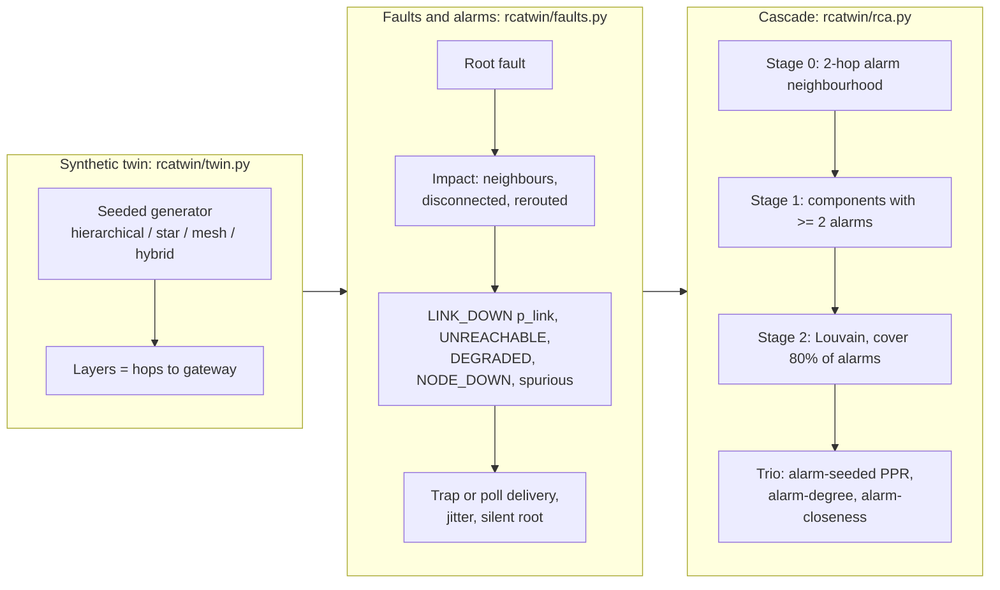
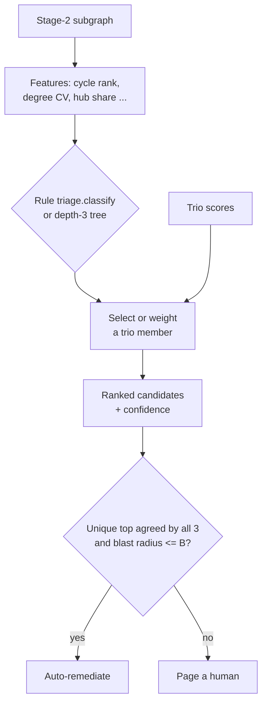
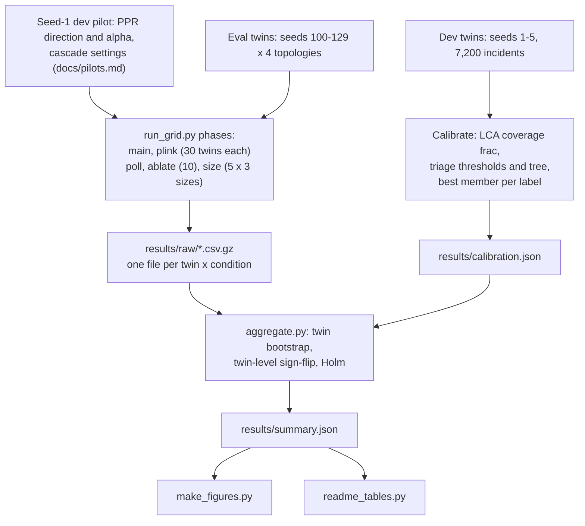
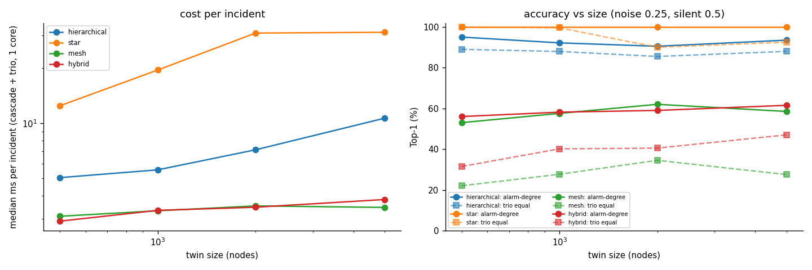
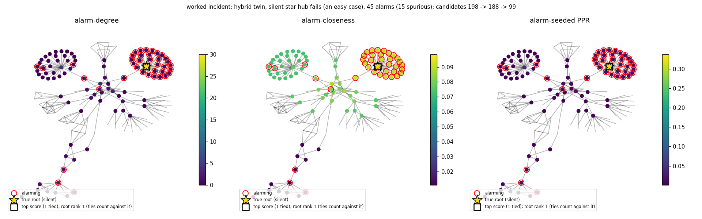

# Alarm-conditioned centrality RCA on a synthetic network digital twin

This repo rebuilds, on synthetic data and a CPU, the root-cause-analysis cascade described in Amazon's
[graph-centric agentic intelligence post](https://www.amazon.science/blog/graph-centric-agentic-intelligence):
a staged search over a network graph, followed by **alarm-conditioned centralities**. These are graph scores
computed only from the nodes that are currently alarming. A triage agent picks among them by the local topology.

I generate seeded network twins, inject faults and simulate the alarm storms that follow (silent roots, spurious
alarms, polling delays, and a varying neighbour-alarm model). I then measure how often each method ranks the
true root first, against classic baselines. CIs come from a twin-clustered bootstrap, and the tests are
twin-level and Holm-corrected.

No LLM or paid API is used. The "agent" is a calibrated rule plus a small decision tree, so every decision can
be audited. All numbers below are rendered from [`results/summary.json`](results/summary.json) by
[`scripts/readme_tables.py`](scripts/readme_tables.py). All figures come from
[`scripts/make_figures.py`](scripts/make_figures.py) run on the committed results.

## Key findings

The main grid has 86,398 scored incidents on 120 eval twins (30 per topology), across 12 noise x silent-root
conditions, with neighbour LINK_DOWN probability p_link = 0.9. A p_link sweep adds 47,841 incidents on the same
120 twins.

1. **Conditioning on alarms beats static centrality almost everywhere, with two scoped exceptions.**
   - Main grid (p_link 0.9), pooled over its 12 conditions: in every topology, each alarm-conditioned centrality
     beats its static counterpart on the same cascade subgraph, by +7.8 to +71.5 pp Top-1. That holds in 30/30
     twins for each of the 12 comparisons, and all are significant under the twin-level test.
   - Per main-grid cell it holds in 83 of 84 topology x noise-level and topology x silent-rate cells. The
     exception: in meshes with an always-silent root, PPR is 1.2 pp *below* static PageRank [-2.1, -0.4]
     (7 twins up, 22 down).
   - In the p_link sweep, PPR and alarm-degree beat their static counterparts in every topology x alarm-model x
     silent-rate cell. The smallest gaps are +6.1 and +5.6 pp, and every CI excludes 0.
   - **Alarm-closeness does not hold up in meshes under upstream-only LINK_DOWN.** It drops to +1.8 pp
     [-0.4, +4.2] (17 twins up, 11 down), and to -1.8 pp [-4.6, +0.9] at silent 0.5 (9 up, 17 down).
2. **Which alarm-conditioned score wins depends on the alarm model.**
   - When neighbours of a failed node reliably raise LINK_DOWN (p_link = 0.9, the main grid), plain
     **alarm-degree** is the best single method: 77.4% Top-1 overall [77.0, 77.9], against 65.1% for the
     equal-weight trio. The best-of-trio oracle reaches 80.8%.
   - Alarm-degree counts exactly the alarms this setting makes plentiful. In the [p_link sweep](#sensitivity-to-the-neighbour-alarm-model-review-m1),
     its pooled lead over equal weights shrinks from +6.0 pp at p_link 0.9 to +1.6 at 0.7. It then **reverses**:
     -4.0 at 0.5, -8.0 at 0.3, and -8.5 when only upstream neighbours raise LINK_DOWN.
   - In meshes the swing runs from +12.8 to -18.0 pp, and to -20.1 pp with the upstream-only model.
   - Alarm-degree's lead also needs **silent roots**. With an alarming root, it never beats equal weights in mesh
     or hybrid twins at any p_link. In the main grid at silent-root probability 0, the mesh numbers are 35.9%
     (alarm-degree), 35.0% (closeness) and 37.6% (equal). At silent-root probability 1 they are 78.7%, 12.8% and 19.6%.
   - **The equal-weight trio is the most stable choice, not the best.** Its pooled Top-1 stays at 64.9-66.1%
     across every p_link and the upstream-only model.
     - Within every topology and alarm model, some other method beats it: the common ancestor or closeness in
       hierarchical twins, earliest-in-cascade in meshes at p_link 0.3 and under upstream-only, and the common
       ancestor in hybrid twins at low p_link.
     - Pooled, it comes out on top only at p_link 0.5, and only narrowly (65.4% vs 64.9%).
3. **My reading of the blog's topology mapping helps only a little, in meshes.**
   - The mapping is PPR for hierarchical, alarm-degree for star and closeness for mesh, with 0.6/0.2 weights.
     The post gives no hard mapping or weights, so these are my choices.
   - Pooled over topologies, it is worse than equal weights: -1.3 pp [-1.5, -1.1] weighted and -4.6 pp
     [-4.8, -4.3] select-one, both significant.
   - The losses are in hierarchical twins (-5.4 / -7.7 pp) and hybrid twins (-1.1 / -6.5 pp).
   - It is slightly better in meshes (weighted +1.0 pp [+0.8, +1.3], 28 of 29 non-zero twins positive) and in star twins (+0.3 pp).
   - Triage itself is accurate: 94.7% balanced accuracy for the rule and 96.5% for the tree on eval twins. Even an
     oracle topology label with these weights scores 64.0%, against 65.1% for equal weights.
   - The **dev-tuned** mapping (+12.0 pp pooled) mostly re-selects alarm-degree, so it inherits alarm-degree's
     dependence on p_link.
4. **The upstream-walk baseline is strong in trees and gets stronger when neighbour alarms are scarce.**
   - The common upstream ancestor reaches 85.0% (hierarchical) and 95.1% (star) Top-1 in the main grid, but
     only 14.6% in meshes. The trio beats it in all four topologies (+4.5 to +13.9 pp).
   - Spurious alarms hurt it: in hierarchical twins it drops from 96.5% to 60.9% as noise goes from 0 to 1.
   - At p_link 0.3 it is the best method in hierarchical twins (91.9%) and hybrid twins (46.2%).
5. **Timing is a trap unless the clocks are ideal.** Earliest alarm in the cascade reaches only 13.3% under
   realistic delivery. With ideal clocks (no noise, no polling, no jitter) it reaches 69-79%, which beats every
   centrality in mesh and hybrid twins.
6. **Ties matter for integer-valued scores.** When ties are split at random instead of counted against the root,
   mesh Top-1 for alarm-degree rises from 57.4% to 69.0%. A closeness tie-break (exploratory, added after the
   first look) recovers only +0.3 pp of that.
7. **The cascade is mostly a cost saver.**
   - Stage 2 (Louvain) shrinks the median candidate set 2-3.5x: hierarchical 99 to 31 nodes, star 817 to 244,
     mesh 30 to 14, hybrid 45 to 15.
   - It keeps the root in 97.5-100% of incidents, but costs alarm-degree 0-7 pp Top-1 compared with stopping after stage 1.
8. **A conservative autonomy gate can work.** Auto-remediate only when all three trio members have the same
   *unique* top node and the blast radius is at most 5 nodes. In the main grid this covers 24.2% of incidents at
   97.2% precision, so 0.7% of all incidents would be auto-remediated on the wrong node.

> **Honest caveats.** I designed both the simulator and the methods. As the p_link sweep shows, the alarm model
> can decide which centrality wins. So read the per-member ranking as conditional on the alarm model. The more
> robust results are Finding 1 (conditioning beats static centralities, with the scoped exceptions listed there)
> and the stability (not superiority) of the equal-weight ensemble. Star-twin roots are almost always hubs, so star results are near-ceiling.
> See [Limitations](#limitations).

## Architecture







## Results

### Top-1 by method and topology (main grid, p_link 0.9)


Data: [`results/main_incidents.csv.gz`](results/main_incidents.csv.gz) · script:
[`scripts/make_figures.py`](scripts/make_figures.py) · summary: [`results/summary.json`](results/summary.json).

Top-1 (%) with the 95% twin-clustered bootstrap CI for "all" (stratified by topology, 30 twins per stratum).
By default ties count against the root; the last column splits ties at random.

<!-- BEGIN:headline -->
| method | all | hierarchical | star | mesh | hybrid | all, ties split |
|---|---|---|---|---|---|---|
| random candidate in cascade | 5.7 [5.5, 5.9] | 5.4 | 0.7 | 8.6 | 8.1 | 5.7 |
| global PageRank (no cascade) | 1.4 [1.3, 1.5] | 0.4 | 5.0 | 0.1 | 0.2 | 1.5 |
| earliest alarm (raw) | 10.2 [9.9, 10.5] | 12.3 | 3.9 | 11.9 | 12.7 | 10.2 |
| earliest alarm in cascade | 13.3 [13.0, 13.6] | 14.6 | 5.8 | 16.7 | 16.0 | 13.3 |
| common upstream ancestor | 57.6 [57.0, 58.2] | 85.0 | 95.1 | 14.6 | 35.7 | 58.7 |
| static PageRank on cascade | 20.2 [19.8, 20.7] | 24.7 | 30.4 | 9.9 | 15.9 | 23.3 |
| static degree on cascade | 18.5 [18.0, 19.0] | 23.7 | 30.0 | 7.0 | 13.3 | 23.9 |
| static closeness on cascade | 22.3 [21.7, 23.0] | 22.5 | 41.3 | 10.3 | 15.2 | 26.3 |
| **alarm-seeded PPR** | 58.7 [58.2, 59.2] | 82.6 | 100.0 | 17.8 | 34.5 | 60.5 |
| **alarm-degree** | 77.4 [77.0, 77.9] | 92.6 | 100.0 | 57.4 | 59.7 | 82.6 |
| **alarm-closeness** | 62.2 [61.5, 62.8] | 94.0 | 93.2 | 23.8 | 37.8 | 68.7 |
| alarm-degree + closeness tie-break (exploratory) | 78.0 [77.6, 78.5] | 93.9 | 100.0 | 57.8 | 60.5 | 82.7 |
| **trio, equal weights** | 65.1 [64.6, 65.6] | 90.6 | 99.6 | 28.5 | 41.8 | 67.7 |
| triage -> blog mapping, select one | 60.5 [60.0, 61.1] | 82.9 | 100.0 | 23.9 | 35.3 | 66.2 |
| triage -> blog mapping, 0.6/0.2 weights | 63.8 [63.3, 64.3] | 85.2 | 99.8 | 29.6 | 40.7 | 66.2 |
| triage -> dev-tuned mapping, select one | 77.1 [76.6, 77.5] | 94.1 | 100.0 | 57.3 | 56.9 | 82.0 |
| triage (decision tree) -> weights | 64.2 [63.7, 64.7] | 85.0 | 99.8 | 29.6 | 42.3 | 66.5 |
| oracle topology label -> weights | 64.0 [63.5, 64.5] | 85.0 | 99.8 | 29.6 | 41.5 | 66.3 |
| oracle best trio member per incident | 80.8 [80.3, 81.2] | 98.7 | 100.0 | 59.9 | 64.5 | 84.9 |
<!-- END:headline -->

### Sensitivity to the neighbour-alarm model (review M1)

![Two rows of four panels, one column per topology. Top row: Top-1 against p_link (0.3 to 0.9), plus hollow diamonds for the upstream-only model. In mesh and hybrid twins alarm-degree rises steeply with p_link, from 14% to 46% (mesh) and from 29% to 51% (hybrid), while equal weights stay flat at about 31-34% and 42-43%. The common ancestor leads in hierarchical twins at low p_link. Bottom row: alarm-degree minus equal weights in pp with 95% CIs, split by silent-root probability. For an alarming root (silent 0) the difference is negative in mesh and hybrid twins at every p_link. In mesh and hybrid twins it is positive only for silent 0.5, and only from p_link 0.7 upward (+16.6 pp mesh, +10.2 pp hybrid). At p_link 0.5 it is within noise (mesh 0.0, hybrid +0.7 pp, both CIs spanning 0). The upstream-only model is negative there. Hierarchical and star differences stay within about ±3 pp.](docs/figures/plink_sensitivity.png)

Data: [`results/plink_incidents.csv.gz`](results/plink_incidents.csv.gz) · grid: [`rcatwin/grid.py`](rcatwin/grid.py)
(`plink` phase: noise 0.25, silent-root probability 0 and 0.5, 40 incidents per condition, seeds 100-129) ·
script: [`scripts/make_figures.py`](scripts/make_figures.py).

Top-1 (%), pooled over silent-root probability 0 and 0.5. The last column is the twin-clustered paired difference.

<!-- BEGIN:plink -->
| topology | p_link | alarm-degree | alarm-closeness | alarm-seeded PPR | trio, equal weights | common upstream ancestor | earliest alarm in cascade | triage -> dev-tuned mapping, select one | alarm-degree - equal (pp) [95% CI], twins +/- |
|---|---|---|---|---|---|---|---|---|---|
| hierarchical | 0.3 | 82.9 | 89.2 | 82.2 | 84.7 | 91.9 | 32.8 | 88.5 | -1.8 [-2.8, -0.9], 2/21 |
| hierarchical | 0.5 | 85.0 | 92.8 | 81.3 | 85.2 | 93.4 | 29.3 | 90.0 | -0.2 [-1.1, +0.6], 11/11 |
| hierarchical | 0.7 | 88.2 | 95.6 | 83.5 | 87.5 | 95.7 | 27.1 | 91.3 | +0.8 [-0.2, +1.7], 14/6 |
| hierarchical | 0.9 | 91.7 | 97.6 | 83.8 | 89.1 | 96.2 | 25.8 | 94.3 | +2.6 [+1.8, +3.5], 29/0 |
| hierarchical | 0.9 upstream-only | 84.3 | 94.4 | 82.0 | 85.0 | 91.8 | 34.6 | 89.2 | -0.7 [-1.5, +0.0], 4/15 |
| star | 0.3 | 100.0 | 92.1 | 100.0 | 99.5 | 94.5 | 13.5 | 100.0 | +0.5 [+0.1, +1.0], 7/0 |
| star | 0.5 | 100.0 | 93.4 | 100.0 | 99.4 | 94.9 | 12.2 | 100.0 | +0.6 [+0.1, +1.3], 9/0 |
| star | 0.7 | 100.0 | 92.0 | 100.0 | 99.3 | 94.8 | 10.1 | 100.0 | +0.7 [+0.2, +1.2], 12/0 |
| star | 0.9 | 100.0 | 93.6 | 100.0 | 99.3 | 94.8 | 12.1 | 100.0 | +0.7 [+0.2, +1.3], 9/0 |
| star | 0.9 upstream-only | 100.0 | 90.8 | 100.0 | 99.1 | 92.9 | 14.5 | 100.0 | +0.9 [+0.4, +1.6], 12/0 |
| mesh | 0.3 | 14.1 | 22.8 | 27.2 | 32.1 | 24.7 | 36.8 | 14.2 | -18.0 [-20.2, -15.5], 0/30 |
| mesh | 0.5 | 23.0 | 24.3 | 25.7 | 34.0 | 22.5 | 31.7 | 23.1 | -11.0 [-13.7, -8.4], 1/29 |
| mesh | 0.7 | 34.9 | 25.7 | 22.8 | 31.3 | 20.4 | 27.8 | 34.9 | +3.6 [+0.9, +6.4], 21/5 |
| mesh | 0.9 | 45.8 | 29.0 | 21.7 | 33.0 | 17.5 | 27.0 | 45.6 | +12.8 [+10.7, +14.8], 30/0 |
| mesh | 0.9 upstream-only | 10.8 | 11.7 | 27.9 | 30.8 | 30.2 | 34.9 | 10.8 | -20.1 [-22.5, -17.7], 0/30 |
| hybrid | 0.3 | 29.1 | 37.6 | 39.3 | 42.1 | 46.2 | 35.4 | 29.9 | -13.1 [-15.1, -11.0], 0/30 |
| hybrid | 0.5 | 37.2 | 39.0 | 38.7 | 42.5 | 44.5 | 32.0 | 38.7 | -5.2 [-7.1, -3.3], 2/26 |
| hybrid | 0.7 | 44.8 | 41.1 | 38.1 | 43.2 | 42.0 | 28.1 | 44.9 | +1.5 [-0.5, +3.7], 16/7 |
| hybrid | 0.9 | 50.9 | 41.9 | 36.4 | 42.8 | 38.5 | 29.2 | 50.3 | +8.1 [+6.3, +9.9], 30/0 |
| hybrid | 0.9 upstream-only | 31.0 | 35.2 | 42.7 | 45.4 | 51.6 | 37.4 | 33.3 | -14.4 [-16.5, -12.1], 0/30 |
| all | 0.3 | 56.8 | 60.7 | 62.4 | 64.9 | 64.6 | 29.6 | 58.4 | -8.0 [-8.9, -7.2], 9/81 |
| all | 0.5 | 61.4 | 62.4 | 61.5 | 65.4 | 63.9 | 26.3 | 63.0 | -4.0 [-4.8, -3.1], 23/66 |
| all | 0.7 | 67.0 | 63.6 | 61.1 | 65.4 | 63.2 | 23.3 | 67.8 | +1.6 [+0.8, +2.5], 63/18 |
| all | 0.9 | 72.1 | 65.5 | 60.5 | 66.1 | 61.7 | 23.5 | 72.6 | +6.0 [+5.3, +6.7], 98/0 |
| all | 0.9 upstream-only | 56.6 | 58.1 | 63.3 | 65.2 | 66.7 | 30.3 | 58.4 | -8.5 [-9.4, -7.7], 16/75 |
<!-- END:plink -->

### Planned comparisons (twin-level, Holm over 40 = 10 per topology)

![Forest plot of the 10 planned paired Top-1 differences per topology, with 95% CIs and per-twin sign counts. Alarm-conditioned vs static centrality, and trio vs timing and upstream baselines, are large and positive in every topology (main grid, pooled over conditions). Blog-reading triage vs equal weights is negative in hierarchical and hybrid twins and slightly positive in mesh and star twins. Dev-tuned triage and alarm-degree vs equal weights are strongly positive in mesh and hybrid twins under the main grid's p_link 0.9.](docs/figures/comparisons_forest.png)

**Test.** The primary p is a two-sided sign-flip test on the 30 per-twin mean differences of each topology.
Incidents within a twin are not independent, so they are not the unit of inference. It uses 20,000 Monte-Carlo
flips, so the smallest attainable p is about 5e-5, and the Holm-adjusted floor over 40 tests is about 0.002. The
twin-level t-test is a parametric cross-check.

**Significance.** A comparison counts as significant only if the Holm p < 0.05 **and** the bootstrap CI excludes 0.

**Caveats.** The star rows are statistically clear but tiny (+0.3 to +0.4 pp). All rows are conditional on the
main grid's alarm model; see the sensitivity section above. The exploratory row is outside the family.

<!-- BEGIN:comparisons -->
| topology | comparison (A vs B) | Top-1 A - B (pp) | 95% CI | twins +/- | twin sign-flip p, Holm | twin t-test p (raw) | significant |
|---|---|---|---|---|---|---|---|
| hierarchical | alarm-seeded PPR vs static PageRank on cascade | +57.8 | [+56.9, +58.8] | 30/0 | 0.002 | <0.001 | **yes** |
| hierarchical | alarm-degree vs static degree on cascade | +68.9 | [+67.9, +69.9] | 30/0 | 0.002 | <0.001 | **yes** |
| hierarchical | alarm-closeness vs static closeness on cascade | +71.5 | [+70.6, +72.4] | 30/0 | 0.002 | <0.001 | **yes** |
| hierarchical | trio, equal weights vs earliest alarm in cascade | +76.0 | [+75.2, +76.9] | 30/0 | 0.002 | <0.001 | **yes** |
| hierarchical | trio, equal weights vs common upstream ancestor | +5.6 | [+4.7, +6.6] | 30/0 | 0.002 | <0.001 | **yes** |
| hierarchical | triage -> blog mapping, 0.6/0.2 weights vs trio, equal weights | -5.4 | [-5.8, -4.9] | 0/30 | 0.002 | <0.001 | **yes** |
| hierarchical | triage -> blog mapping, select one vs trio, equal weights | -7.7 | [-8.3, -7.1] | 0/30 | 0.002 | <0.001 | **yes** |
| hierarchical | triage -> dev-tuned mapping, select one vs trio, equal weights | +3.5 | [+3.1, +4.0] | 30/0 | 0.002 | <0.001 | **yes** |
| hierarchical | triage (decision tree) -> weights vs trio, equal weights | -5.6 | [-6.1, -5.1] | 0/30 | 0.002 | <0.001 | **yes** |
| hierarchical | alarm-degree vs trio, equal weights | +2.0 | [+1.6, +2.3] | 30/0 | 0.002 | <0.001 | **yes** |
| hierarchical | alarm-degree + closeness tie-break (exploratory) vs alarm-degree *(exploratory)* | +1.3 | [+1.1, +1.5] | 30/0 | unadjusted <0.001 | <0.001 | n/a |
| star | alarm-seeded PPR vs static PageRank on cascade | +69.6 | [+68.3, +71.0] | 30/0 | 0.002 | <0.001 | **yes** |
| star | alarm-degree vs static degree on cascade | +70.0 | [+68.7, +71.4] | 30/0 | 0.002 | <0.001 | **yes** |
| star | alarm-closeness vs static closeness on cascade | +51.9 | [+50.2, +53.5] | 30/0 | 0.002 | <0.001 | **yes** |
| star | trio, equal weights vs earliest alarm in cascade | +93.8 | [+93.3, +94.2] | 30/0 | 0.002 | <0.001 | **yes** |
| star | trio, equal weights vs common upstream ancestor | +4.5 | [+3.4, +5.7] | 28/1 | 0.002 | <0.001 | **yes** |
| star | triage -> blog mapping, 0.6/0.2 weights vs trio, equal weights | +0.3 | [+0.1, +0.5] | 16/0 | 0.002 | 0.006 | **yes** |
| star | triage -> blog mapping, select one vs trio, equal weights | +0.4 | [+0.2, +0.8] | 22/0 | 0.002 | 0.005 | **yes** |
| star | triage -> dev-tuned mapping, select one vs trio, equal weights | +0.4 | [+0.2, +0.8] | 21/1 | 0.002 | 0.008 | **yes** |
| star | triage (decision tree) -> weights vs trio, equal weights | +0.3 | [+0.1, +0.5] | 16/0 | 0.002 | 0.006 | **yes** |
| star | alarm-degree vs trio, equal weights | +0.4 | [+0.2, +0.8] | 22/0 | 0.002 | 0.005 | **yes** |
| star | alarm-degree + closeness tie-break (exploratory) vs alarm-degree *(exploratory)* | +0.0 | [+0.0, +0.0] | 0/0 | unadjusted 1.000 | 1.000 | n/a |
| mesh | alarm-seeded PPR vs static PageRank on cascade | +7.8 | [+7.2, +8.5] | 30/0 | 0.002 | <0.001 | **yes** |
| mesh | alarm-degree vs static degree on cascade | +50.4 | [+49.3, +51.6] | 30/0 | 0.002 | <0.001 | **yes** |
| mesh | alarm-closeness vs static closeness on cascade | +13.5 | [+12.6, +14.3] | 30/0 | 0.002 | <0.001 | **yes** |
| mesh | trio, equal weights vs earliest alarm in cascade | +11.8 | [+10.6, +13.0] | 30/0 | 0.002 | <0.001 | **yes** |
| mesh | trio, equal weights vs common upstream ancestor | +13.9 | [+13.0, +14.9] | 30/0 | 0.002 | <0.001 | **yes** |
| mesh | triage -> blog mapping, 0.6/0.2 weights vs trio, equal weights | +1.0 | [+0.8, +1.3] | 28/1 | 0.002 | <0.001 | **yes** |
| mesh | triage -> blog mapping, select one vs trio, equal weights | -4.6 | [-5.2, -4.1] | 0/30 | 0.002 | <0.001 | **yes** |
| mesh | triage -> dev-tuned mapping, select one vs trio, equal weights | +28.8 | [+27.8, +29.7] | 30/0 | 0.002 | <0.001 | **yes** |
| mesh | triage (decision tree) -> weights vs trio, equal weights | +1.0 | [+0.8, +1.3] | 28/1 | 0.002 | <0.001 | **yes** |
| mesh | alarm-degree vs trio, equal weights | +28.9 | [+28.0, +29.8] | 30/0 | 0.002 | <0.001 | **yes** |
| mesh | alarm-degree + closeness tie-break (exploratory) vs alarm-degree *(exploratory)* | +0.3 | [+0.2, +0.5] | 27/0 | unadjusted <0.001 | <0.001 | n/a |
| hybrid | alarm-seeded PPR vs static PageRank on cascade | +18.6 | [+17.1, +20.0] | 30/0 | 0.002 | <0.001 | **yes** |
| hybrid | alarm-degree vs static degree on cascade | +46.4 | [+45.3, +47.5] | 30/0 | 0.002 | <0.001 | **yes** |
| hybrid | alarm-closeness vs static closeness on cascade | +22.6 | [+21.0, +24.4] | 30/0 | 0.002 | <0.001 | **yes** |
| hybrid | trio, equal weights vs earliest alarm in cascade | +25.8 | [+23.9, +27.9] | 30/0 | 0.002 | <0.001 | **yes** |
| hybrid | trio, equal weights vs common upstream ancestor | +6.1 | [+4.9, +7.3] | 29/1 | 0.002 | <0.001 | **yes** |
| hybrid | triage -> blog mapping, 0.6/0.2 weights vs trio, equal weights | -1.1 | [-1.5, -0.8] | 1/25 | 0.002 | <0.001 | **yes** |
| hybrid | triage -> blog mapping, select one vs trio, equal weights | -6.5 | [-7.1, -5.9] | 0/30 | 0.002 | <0.001 | **yes** |
| hybrid | triage -> dev-tuned mapping, select one vs trio, equal weights | +15.1 | [+14.1, +16.1] | 30/0 | 0.002 | <0.001 | **yes** |
| hybrid | triage (decision tree) -> weights vs trio, equal weights | +0.4 | [+0.1, +0.8] | 21/6 | 0.002 | <0.001 | **yes** |
| hybrid | alarm-degree vs trio, equal weights | +17.8 | [+16.8, +18.9] | 30/0 | 0.002 | <0.001 | **yes** |
| hybrid | alarm-degree + closeness tie-break (exploratory) vs alarm-degree *(exploratory)* | +0.8 | [+0.6, +1.0] | 30/0 | unadjusted <0.001 | <0.001 | n/a |
<!-- END:comparisons -->

Pooled over topologies (a second Holm family of 10, twins are the units, 120 twins):

<!-- BEGIN:pooled -->
| topology | comparison (A vs B) | Top-1 A - B (pp) | 95% CI | twins +/- | twin sign-flip p, Holm | twin t-test p (raw) | significant |
|---|---|---|---|---|---|---|---|
| all (pooled) | alarm-seeded PPR vs static PageRank on cascade | +38.5 | [+37.9, +39.0] | 120/0 | <0.001 | <0.001 | **yes** |
| all (pooled) | alarm-degree vs static degree on cascade | +58.9 | [+58.3, +59.5] | 120/0 | <0.001 | <0.001 | **yes** |
| all (pooled) | alarm-closeness vs static closeness on cascade | +39.9 | [+39.2, +40.5] | 120/0 | <0.001 | <0.001 | **yes** |
| all (pooled) | trio, equal weights vs earliest alarm in cascade | +51.9 | [+51.3, +52.5] | 120/0 | <0.001 | <0.001 | **yes** |
| all (pooled) | trio, equal weights vs common upstream ancestor | +7.5 | [+7.0, +8.1] | 117/2 | <0.001 | <0.001 | **yes** |
| all (pooled) | triage -> blog mapping, 0.6/0.2 weights vs trio, equal weights | -1.3 | [-1.5, -1.1] | 45/56 | <0.001 | <0.001 | **yes** |
| all (pooled) | triage -> blog mapping, select one vs trio, equal weights | -4.6 | [-4.8, -4.3] | 22/90 | <0.001 | <0.001 | **yes** |
| all (pooled) | triage -> dev-tuned mapping, select one vs trio, equal weights | +12.0 | [+11.6, +12.3] | 111/1 | <0.001 | <0.001 | **yes** |
| all (pooled) | triage (decision tree) -> weights vs trio, equal weights | -1.0 | [-1.1, -0.8] | 65/37 | <0.001 | <0.001 | **yes** |
| all (pooled) | alarm-degree vs trio, equal weights | +12.3 | [+11.9, +12.7] | 112/0 | <0.001 | <0.001 | **yes** |
| all (pooled) | alarm-degree + closeness tie-break (exploratory) vs alarm-degree *(exploratory)* | +0.6 | [+0.5, +0.7] | 87/0 | unadjusted <0.001 | <0.001 | n/a |
<!-- END:pooled -->

### Robustness: noise and silent roots


Data: [`results/main_incidents.csv.gz`](results/main_incidents.csv.gz) · script: [`scripts/make_figures.py`](scripts/make_figures.py)

### Ties

<!-- BEGIN:ties -->
| method | hierarchical: pessimistic / ties split | star: pessimistic / ties split | mesh: pessimistic / ties split | hybrid: pessimistic / ties split |
|---|---|---|---|---|
| **alarm-seeded PPR** | 82.6 / 82.6 | 100.0 / 100.0 | 17.8 / 21.8 | 34.5 / 37.5 |
| **alarm-degree** | 92.6 / 93.3 | 100.0 / 100.0 | 57.4 / 69.0 | 59.7 / 68.0 |
| **alarm-closeness** | 94.0 / 95.3 | 93.2 / 93.4 | 23.8 / 38.3 | 37.8 / 47.8 |
| alarm-degree + closeness tie-break (exploratory) | 93.9 / 93.9 | 100.0 / 100.0 | 57.8 / 68.9 | 60.5 / 68.0 |
| **trio, equal weights** | 90.6 / 91.1 | 99.6 / 99.6 | 28.5 / 34.1 | 41.8 / 45.8 |
| common upstream ancestor | 85.0 / 85.0 | 95.1 / 95.1 | 14.6 / 17.7 | 35.7 / 36.9 |
| triage -> dev-tuned mapping, select one | 94.1 / 94.7 | 100.0 / 100.0 | 57.3 / 68.8 | 56.9 / 64.4 |
<!-- END:ties -->

Expected Top-1 under random tie-breaking is `[opt == 1] / (pess - opt + 1)`
([`rcatwin/rca.py`](rcatwin/rca.py) `expected_top1`). The tie diagnosis is in
[`docs/pilots.md`](docs/pilots.md) (decision 6).

### Cascade funnel and stage ablations


Data: [`results/ablate_incidents.csv.gz`](results/ablate_incidents.csv.gz), [`results/main_incidents.csv.gz`](results/main_incidents.csv.gz) ·
script: [`scripts/make_figures.py`](scripts/make_figures.py).

The ablation uses noise 0.25, silent 0.5, and 100 incidents x 10 twins per topology. `no_decompose` stops after
stage 0 and `no_cluster` after stage 1. They coincide whenever stage 1 drops no component that would change
the root's rank.

<!-- BEGIN:ablate -->
| variant | hierarchical | star | mesh | hybrid |
|---|---|---|---|---|
| `equal` | 88.3 [85.2, 91.3] | 99.0 [97.5, 99.9] | 27.1 [23.5, 30.6] | 38.4 [34.1, 42.6] |
| `alarm_degree` | 92.0 [89.4, 94.4] | 100.0 [100.0, 100.0] | 58.2 [53.9, 62.1] | 56.0 [51.5, 60.4] |
| `ppr` | 83.5 [80.3, 86.8] | 100.0 [100.0, 100.0] | 16.9 [13.7, 20.2] | 31.8 [28.1, 35.5] |
| `alarm_closeness@hops1` | 97.5 [96.0, 98.8] | 88.6 [83.1, 92.9] | 23.7 [20.1, 27.0] | 34.7 [30.5, 38.9] |
| `alarm_closeness@hops3` | 94.1 [91.6, 96.4] | 89.9 [84.0, 94.6] | 22.4 [19.3, 25.5] | 35.5 [30.9, 40.0] |
| `alarm_closeness@no_cluster` | 87.2 [83.6, 90.3] | 91.0 [84.7, 95.8] | 28.7 [24.9, 32.2] | 38.0 [33.0, 43.0] |
| `alarm_closeness@no_decompose` | 87.2 [83.6, 90.3] | 91.0 [84.7, 95.8] | 28.7 [24.9, 32.2] | 38.0 [33.0, 43.0] |
| `alarm_degree@hops1` | 91.7 [89.3, 94.0] | 100.0 [100.0, 100.0] | 58.1 [53.6, 62.3] | 54.8 [50.4, 59.0] |
| `alarm_degree@hops3` | 93.7 [91.5, 95.8] | 100.0 [100.0, 100.0] | 58.7 [54.1, 62.7] | 56.5 [51.7, 61.2] |
| `alarm_degree@no_cluster` | 95.8 [94.0, 97.5] | 100.0 [100.0, 100.0] | 65.1 [60.1, 69.1] | 60.5 [56.2, 64.6] |
| `alarm_degree@no_decompose` | 95.8 [94.0, 97.5] | 100.0 [100.0, 100.0] | 65.1 [60.1, 69.1] | 60.5 [56.2, 64.6] |
| `equal@hops1` | 87.5 [84.3, 90.3] | 97.8 [96.0, 99.2] | 24.7 [20.9, 28.3] | 36.2 [31.8, 40.4] |
| `equal@hops3` | 88.6 [85.9, 91.2] | 99.0 [97.5, 99.9] | 26.6 [22.9, 30.1] | 38.7 [34.5, 42.8] |
| `equal@no_cluster` | 91.6 [89.0, 94.0] | 99.1 [97.6, 100.0] | 28.1 [24.2, 31.6] | 40.5 [36.2, 44.7] |
| `equal@no_decompose` | 91.6 [89.0, 94.0] | 99.1 [97.6, 100.0] | 27.9 [24.0, 31.4] | 39.9 [35.4, 44.2] |
| `ppr@hops1` | 68.1 [64.3, 71.9] | 100.0 [100.0, 100.0] | 10.8 [8.3, 13.4] | 25.4 [21.9, 29.0] |
| `ppr@hops3` | 82.9 [79.9, 86.0] | 100.0 [100.0, 100.0] | 15.5 [12.6, 18.6] | 30.9 [27.3, 34.4] |
| `ppr@no_cluster` | 82.7 [79.5, 85.8] | 100.0 [100.0, 100.0] | 14.5 [11.4, 17.8] | 29.8 [25.8, 33.8] |
| `ppr@no_decompose` | 82.7 [79.5, 85.8] | 100.0 [100.0, 100.0] | 14.4 [11.2, 17.8] | 29.6 [25.6, 33.5] |
| `ppr@ppr_alpha50` | 81.5 [78.6, 84.6] | 100.0 [100.0, 100.0] | 17.5 [15.0, 20.0] | 29.1 [25.4, 32.6] |
| `ppr@ppr_alpha95` | 81.2 [77.8, 84.6] | 99.8 [99.2, 100.0] | 16.3 [13.2, 19.7] | 30.6 [27.0, 34.3] |
| `ppr@ppr_directed` | 19.1 [15.9, 22.4] | 87.8 [85.1, 90.4] | 6.7 [4.6, 9.0] | 20.2 [17.0, 23.5] |
<!-- END:ablate -->

### Triage agent


The rule thresholds (cycle rank >= 0.4 means mesh, degree CV >= 2.6 means star) and the tree were fitted on dev
seeds only ([`results/calibration.json`](results/calibration.json)). `aggregate.calibrate` refuses non-dev
seeds, and a test enforces this.

### Polling interval and ideal clocks


Data: [`results/poll_incidents.csv.gz`](results/poll_incidents.csv.gz) (10 twins per topology, descriptive) · script: [`scripts/make_figures.py`](scripts/make_figures.py)

### Twin size



Data: [`results/size_incidents.csv.gz`](results/size_incidents.csv.gz) · script: [`scripts/make_figures.py`](scripts/make_figures.py)

### Graduated autonomy


Gate table: [`results/autonomy_gate.csv`](results/autonomy_gate.csv). It uses the main grid and the equal-weight
trio's top candidate. `wrong_auto` is the share of *all* incidents auto-remediated on the wrong node. A member
whose top score is tied never counts as agreeing.

### What the twins and two worked incidents look like





## Method in brief

See [`docs/method.md`](docs/method.md) for the generators, the fault and alarm model, the methods and the
statistics. See [`docs/pilots.md`](docs/pilots.md) for the decisions made on dev seeds and the post-hoc tie handling.

- **Baselines:** a random cascade candidate, global PageRank, and earliest alarm (raw and inside the cascade).
  The common upstream ancestor is the deepest node covering at least 50% of the best alarm coverage; the 50%
  was chosen on dev. Static PageRank, degree and closeness are computed on the same cascade subgraph.
- **Statistics:**
  - Top-1, Top-5, MRR and ties-split Top-1.
  - A 2,000-replicate twin-clustered bootstrap (stratified by topology when pooled).
  - Twin-level sign-flip tests with Holm correction; twin-level t-tests as a cross-check.
- **Seeds:** dev seeds 1-5 are used only for pilots and calibration. Eval seeds 100-109 were run after calibration
  was frozen, and seeds 110-129 were added in review round 1 to make twin-level tests possible. The tie
  handling (post hoc, reported both ways) and the p_link sweep (requested in review) are the only changes made
  after seeing eval numbers.

## Reproduce

```bash
python3 -m venv .venv && .venv/bin/pip install -r requirements-dev.txt   # pinned; requirements-lock.txt = full freeze
.venv/bin/python -m pytest -q                                              # unit tests (61)
.venv/bin/python scripts/mutation_check.py                                 # 72 single-line mutants, all must be killed
mkdir -p logs
# results/raw is committed and run_grid.py skips existing files, so recompute into a scratch directory
# (or pass --force to overwrite results/raw in place):
nohup .venv/bin/python scripts/run_grid.py --phase dev main plink poll ablate size --workers 8 --out /tmp/rca_raw > logs/grid.log 2>&1 &
wait   # the grid must finish first; aggregate.py refuses an incomplete raw dir (exit 2) and lists what is missing
.venv/bin/python scripts/aggregate.py --raw /tmp/rca_raw          # writes results/*.json and *_incidents.csv.gz
.venv/bin/python scripts/make_figures.py && .venv/bin/python scripts/readme_tables.py --write
```

The full grid takes about 25-40 minutes on this 8-core CPU box: I measured about 25 min with 8 workers, and the
reviewer measured about 37 min with 7. Aggregation takes about 7 minutes. Each twin x condition is
written atomically, so an interrupted run resumes where it stopped. Randomness is seeded from
`(seed, crc32(kind|n|condition), incident)`. A full rerun from scratch reproduces every committed raw file
outside the `ms_*` timing columns. The figures reproduce pixel-identically from the same results, except
`docs/figures/size_scaling.png`: its left panel plots measured runtimes, so it changes from run to run. Scripts resolve paths from their own location, so they can run from any directory.

**Quality gates:**
- [`tests/`](tests) covers the generators, the impact and alarm model (including p_link and the upstream-only
  model), the cascade, the centralities and ties, the ensemble, `run_incident` ranks and the tie-break, the
  autonomy confidence, and the bootstrap, CI level, sign-flip and twin-level tests and Holm.
- It also covers the aggregation path: dev-only calibration, the triage rule, the oracle, the blog-reading
  mapping and weights, and the significance rule.
- It covers the twin-level statistics too: twin ids (kind, seed), topology-stratified pooled bootstrap,
  twins_pos/neg with zero-difference twins, the pooled and per-topology Holm families, and twin means with
  unequal twins. It also checks the grid-completeness guard, that dev and eval seeds are disjoint, and that the
  p_link sweep stays a sweep.
- [`scripts/mutation_check.py`](scripts/mutation_check.py) applies 72 single-line mutants, including the
  reviewer's, to `rcatwin/` and `scripts/aggregate.py`. Every one must make a test fail
  ([`results/mutation_check.json`](results/mutation_check.json)). The mutants that cannot be killed because
  they are true equivalents are listed with reasons in [`docs/mutation.md`](docs/mutation.md).

## Limitations

- **One author.** The simulator and the methods were written by the same person. The p_link sweep shows that a
  single alarm-model parameter can flip the ranking of trio members. The other alarm probabilities, delays and
  topologies are plausible but not fitted to real NOC data either.
- **Star twins.** Star roots are almost always hubs (leaves rarely meet the blast-radius minimum of 3), so star results are near-ceiling.
- **Repeated roots.** Roots are drawn with replacement from each twin's eligible roots: about 20 distinct roots
  per star twin, about 220 per hierarchical twin and about 500 per mesh twin. That is why twins, not incidents,
  are the unit of inference.
- **Scope.** Single-root faults only. There are no concurrent incidents, maintenance windows or alarm correlation rules.
- **Post-hoc metrics.** The ties-split metric and the closeness tie-break were added after the first eval pass.
  They are reported as secondary and exploratory. The pessimistic Top-1 stays primary.
- **No LLM.** The "agent" is a rule plus a tree. That keeps it auditable and free, but it does not test LLM-based triage.
- **License:** MIT ([`LICENSE`](LICENSE)).
