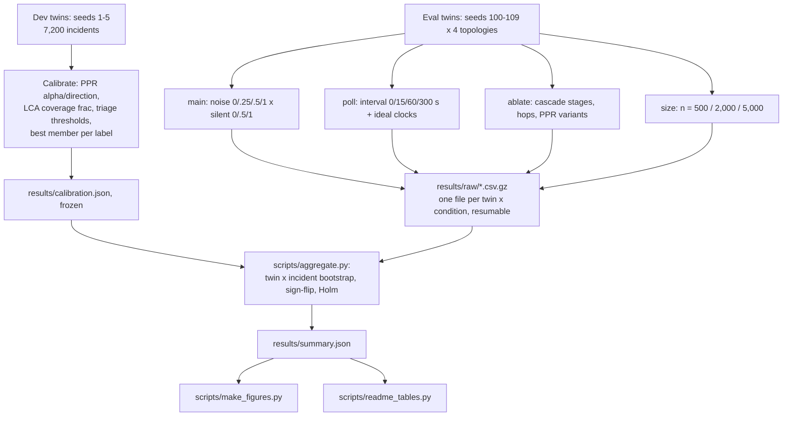
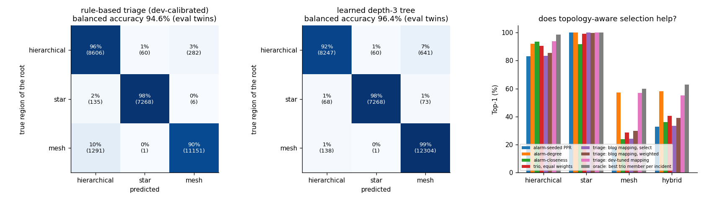
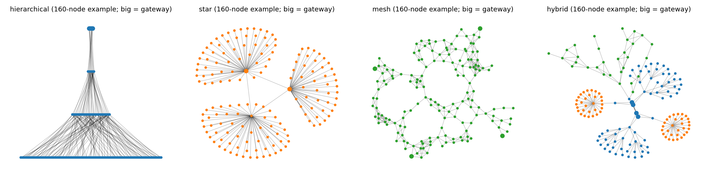

# Alarm-conditioned centrality RCA on a synthetic network digital twin

This repo rebuilds, on synthetic data and a CPU, the root-cause-analysis cascade from Amazon's
network-operations work: a staged search over a network graph, followed by **alarm-conditioned centralities**.
These are graph scores computed only from the nodes that are currently alarming. A triage agent then picks
the centrality that suits the local topology. I generate thousands of seeded network twins, inject faults,
simulate the resulting alarm storms (including silent roots, spurious alarms and polling delays), and
measure how often each method ranks the true root cause first. I compare against classic baselines, with
cluster-bootstrap CIs and Holm-corrected paired tests.

No LLM or paid API is used. The "agent" is a calibrated rule plus a small decision tree, so every decision
can be audited. All numbers below are rendered from [`results/summary.json`](results/summary.json) by
[`scripts/readme_tables.py`](scripts/readme_tables.py). All figures come from
[`scripts/make_figures.py`](scripts/make_figures.py) run on the committed results.

## Key findings (main grid: 28,800 incidents, 40 eval twins, 12 noise x silent-root conditions)

1. **Conditioning on alarms is what matters.** In every topology, each alarm-conditioned centrality beats its
   static counterpart computed on the same cascade subgraph, by +8 to +71 pp Top-1. All 12 of these comparisons
   are Holm-significant, with CIs far from 0. For example, alarm-degree vs static degree is +68 pp
   (hierarchical) and +50 pp (mesh).
2. **Plain alarm-degree is the strongest single method: 76.8% Top-1 overall [76.0, 77.6].** The best-of-trio
   oracle reaches 80.3%. Alarm-degree beats the equal-weight trio ensemble in every topology, by +28.5 pp in
   mesh and +17.6 pp in hybrid twins. **Most of that mesh/hybrid lead comes from silent roots.** When the root
   always alarms, alarm-degree in meshes reaches only 36.5%, level with closeness (36.0%) and equal weights
   (38.5%). When the root never alarms, it reaches 77.5%, while the others fall to 13-20%. A root's own alarm
   raises the alarm-degree of every neighbour, so in clustered meshes a neighbour can match or pass the root.
3. **The blog's topology-to-centrality mapping did not help here.** The mapping is PPR for hierarchical,
   degree for star and closeness for mesh. Triage itself is accurate (94.6% balanced accuracy for the rule,
   96.4% for the tree). But using the blog mapping on top of it is *worse* than equal weights in hierarchical
   twins (-5.1 / -7.2 pp) and in hybrid twins (-1.3 / -7.0 pp). The **dev-tuned** mapping is fitted on 7,200
   development incidents and picks alarm-degree for mesh. It gains +0.7 to +28 pp, which means it recovers
   alarm-degree. Even an *oracle* topology label with the blog weights only reaches 63.7%.
4. **Upstream-walk baselines are strong in trees and weak in meshes.** The common upstream ancestor reaches
   85% (hierarchical) and 95% (star) Top-1, but only 14.5% in meshes. Spurious alarms also hurt it: in
   hierarchical twins it falls from 96% to 62% as noise rises from 0 to 1 spurious alarm per true alarm. The trio still beats it in all four
   topologies (+4 to +14 pp).
5. **Timing is a trap unless the clocks are ideal.** Earliest alarm in the cascade reaches only 13% Top-1 under
   realistic delivery (trap/poll mix, jitter, pre-fault noise). With ideal clocks (no noise, no polling, no
   jitter) it jumps to 69-79%, which beats every centrality in mesh and hybrid twins. Silent roots hurt it the
   most.
6. **Ties matter for integer-valued scores.** In meshes, alarm-degree often ties the root with a neighbour. When
   ties are split at random instead of counted against the root, mesh Top-1 rises from 57.2% to 69.0%. A
   closeness tie-break (exploratory, added after the first look) recovers only +0.4 pp of that.
7. **The cascade is mostly a cost saver.** Stage 2 (Louvain) shrinks the median candidate set 2-3.5x. Hierarchical
   goes from 98 to 30 nodes, star from 820 to 237, mesh from 30 to 14 and hybrid from 40 to 14. The root stays
   in the set in 97.5-100% of incidents. But stage 2 costs alarm-degree 0-7 pp Top-1 compared with stopping
   after stage 1 (mesh: 58.2% vs 65.1%). The hop radius barely matters, except for
   PPR at 1 hop.
8. **A graduated-autonomy gate can work, conservatively.** Act automatically only when all three trio members
   agree and the blast radius is at most 5 nodes. That covers 31.5% of incidents at 76.5% precision, with
   7.4% of all incidents wrongly auto-remediated. Without the blast-radius cap, coverage is 62% at 86% precision.

> **Honest caveats.** I designed both the simulator and the methods, so absolute numbers reflect my modelling
> choices. Comparisons between methods on the same incidents are more trustworthy than the levels. Star-twin
> roots are almost always hubs, so star results are near-ceiling for most methods. See
> [Limitations](#limitations).

## Architecture

```mermaid
flowchart LR
    subgraph Twin["Synthetic digital twin (rcatwin/twin.py)"]
        G[Seeded graph generator:<br/>hierarchical / star / mesh / hybrid] --> L[Layers = hops to gateway<br/>upstream DAG]
    end
    subgraph Sim["Fault & alarm simulator (rcatwin/faults.py)"]
        F[Root fault] --> I[Impact: neighbours, disconnected,<br/>rerouted nodes]
        I --> A[Alarms: LINK_DOWN / UNREACHABLE /<br/>DEGRADED / NODE_DOWN + spurious]
        A --> D[Delivery: trap latency or poll,<br/>jitter, silent root]
    end
    subgraph RCA["RCA cascade (rcatwin/rca.py)"]
        S0[Stage 0: 2-hop alarm<br/>neighbourhood] --> S1[Stage 1: connected components<br/>with >= 2 alarms]
        S1 --> S2[Stage 2: Louvain communities<br/>covering 80% of alarms]
        S2 --> C[Alarm-conditioned trio:<br/>PPR, alarm-degree, alarm-closeness]
    end
    subgraph Agent["Triage agent (rcatwin/triage.py)"]
        T[Subgraph features:<br/>cycle rank, degree CV, hub share...] --> R{rule or<br/>depth-3 tree}
        R --> W[select / weight<br/>trio member]
    end
    L --> F
    D --> S0
    S2 --> T
    C --> W
    W --> O[Ranked root-cause candidates<br/>+ confidence]
    O --> GATE{Autonomy gate:<br/>trio agrees & blast <= B}
    GATE -->|yes| AUTO[auto-remediate]
    GATE -->|no| HUMAN[page a human]
```





## Results

### Top-1 by method and topology


Data: [`results/main_incidents.csv.gz`](results/main_incidents.csv.gz) · script:
[`scripts/make_figures.py`](scripts/make_figures.py) · summary: [`results/summary.json`](results/summary.json).

Top-1 (%) with the 95% twin x incident cluster-bootstrap CI for "all". By default, ties count against the
root. The last column splits ties at random.

<!-- BEGIN:headline -->
| method | all | hierarchical | star | mesh | hybrid | all, ties split |
|---|---|---|---|---|---|---|
| random candidate in cascade | 5.9 [5.5, 6.2] | 5.4 | 0.8 | 8.5 | 8.7 | 5.9 |
| global PageRank (no cascade) | 1.3 [1.2, 1.6] | 0.4 | 4.7 | 0.2 | 0.2 | 1.4 |
| earliest alarm (raw) | 10.1 [9.6, 10.6] | 11.9 | 3.5 | 12.2 | 12.8 | 10.1 |
| earliest alarm in cascade | 13.3 [12.8, 13.8] | 14.3 | 5.3 | 17.2 | 16.6 | 13.3 |
| common upstream ancestor | 57.3 [56.3, 58.3] | 85.2 | 94.9 | 14.5 | 34.5 | 58.4 |
| static PageRank on cascade | 20.0 [19.3, 20.8] | 25.0 | 30.2 | 9.7 | 15.1 | 23.2 |
| static degree on cascade | 18.1 [17.4, 18.9] | 23.9 | 29.5 | 6.8 | 12.4 | 23.8 |
| static closeness on cascade | 21.9 [20.7, 23.0] | 22.4 | 40.0 | 10.2 | 14.9 | 26.0 |
| **alarm-seeded PPR** | 58.4 [57.6, 59.3] | 83.1 | 100.0 | 17.8 | 32.9 | 60.3 |
| **alarm-degree** | 76.8 [76.0, 77.6] | 92.1 | 100.0 | 57.2 | 58.0 | 82.1 |
| **alarm-closeness** | 61.4 [60.2, 62.5] | 93.6 | 91.8 | 23.9 | 36.1 | 68.0 |
| alarm-degree + closeness tie-break (exploratory) | 77.5 [76.7, 78.3] | 93.5 | 100.0 | 57.7 | 58.8 | 82.3 |
| **trio, equal weights** | 64.8 [63.9, 65.6] | 90.6 | 99.3 | 28.7 | 40.5 | 67.4 |
| triage -> blog mapping, select one | 60.2 [59.4, 61.0] | 83.4 | 100.0 | 24.0 | 33.4 | 66.0 |
| triage -> blog mapping, 0.6/0.2 weights | 63.6 [62.7, 64.4] | 85.5 | 99.8 | 29.8 | 39.2 | 66.0 |
| triage -> dev-tuned mapping, select one | 76.5 [75.7, 77.2] | 93.8 | 100.0 | 57.0 | 55.1 | 81.5 |
| triage (decision tree) -> weights | 64.0 [63.1, 64.8] | 85.3 | 99.8 | 29.8 | 41.0 | 66.5 |
| oracle topology label -> weights | 63.7 [62.9, 64.5] | 85.3 | 99.8 | 29.8 | 40.1 | 66.2 |
| oracle best trio member per incident | 80.3 [79.5, 81.1] | 98.5 | 100.0 | 59.9 | 62.9 | 84.6 |
<!-- END:headline -->

### Planned comparisons (Holm over 40 = 10 per topology)


A comparison counts as significant only if the Holm-adjusted p < 0.05 **and** the bootstrap CI excludes 0.
p-values come from an incident-level two-sided sign-flip test with 5,000 flips. The smallest attainable raw p
is about 2e-4, so the Holm-adjusted floor is 0.008. The exploratory row is outside the family.

<!-- BEGIN:comparisons -->
| topology | comparison (A vs B) | Top-1 A - B (pp) | 95% CI | Holm p | significant |
|---|---|---|---|---|---|
| hierarchical | alarm-seeded PPR vs static PageRank on cascade | +58.0 | [+56.2, +59.7] | 0.008 | yes |
| hierarchical | alarm-degree vs static degree on cascade | +68.2 | [+66.5, +69.9] | 0.008 | yes |
| hierarchical | alarm-closeness vs static closeness on cascade | +71.2 | [+69.8, +72.6] | 0.008 | yes |
| hierarchical | trio, equal weights vs earliest alarm in cascade | +76.3 | [+74.7, +77.9] | 0.008 | yes |
| hierarchical | trio, equal weights vs common upstream ancestor | +5.4 | [+3.6, +7.1] | 0.008 | yes |
| hierarchical | triage -> blog mapping, 0.6/0.2 weights vs trio, equal weights | -5.1 | [-6.0, -4.2] | 0.008 | yes |
| hierarchical | triage -> blog mapping, select one vs trio, equal weights | -7.2 | [-8.4, -6.1] | 0.008 | yes |
| hierarchical | triage -> dev-tuned mapping, select one vs trio, equal weights | +3.2 | [+2.4, +4.0] | 0.008 | yes |
| hierarchical | triage (decision tree) -> weights vs trio, equal weights | -5.3 | [-6.2, -4.4] | 0.008 | yes |
| hierarchical | alarm-degree vs trio, equal weights | +1.6 | [+1.1, +2.0] | 0.008 | yes |
| hierarchical | alarm-degree + closeness tie-break (exploratory) vs alarm-degree *(exploratory)* | +1.4 | [+1.0, +1.8] | unadjusted 0.0002 | n/a |
| star | alarm-seeded PPR vs static PageRank on cascade | +69.8 | [+67.6, +72.0] | 0.008 | yes |
| star | alarm-degree vs static degree on cascade | +70.5 | [+68.2, +72.9] | 0.008 | yes |
| star | alarm-closeness vs static closeness on cascade | +51.8 | [+50.1, +53.5] | 0.008 | yes |
| star | trio, equal weights vs earliest alarm in cascade | +94.0 | [+93.1, +94.8] | 0.008 | yes |
| star | trio, equal weights vs common upstream ancestor | +4.4 | [+2.3, +6.8] | 0.008 | yes |
| star | triage -> blog mapping, 0.6/0.2 weights vs trio, equal weights | +0.5 | [+0.1, +1.0] | 0.008 | yes |
| star | triage -> blog mapping, select one vs trio, equal weights | +0.7 | [+0.2, +1.5] | 0.008 | yes |
| star | triage -> dev-tuned mapping, select one vs trio, equal weights | +0.7 | [+0.2, +1.5] | 0.008 | yes |
| star | triage (decision tree) -> weights vs trio, equal weights | +0.5 | [+0.1, +1.0] | 0.008 | yes |
| star | alarm-degree vs trio, equal weights | +0.7 | [+0.2, +1.5] | 0.008 | yes |
| star | alarm-degree + closeness tie-break (exploratory) vs alarm-degree *(exploratory)* | +0.0 | [+0.0, +0.0] | unadjusted 1 | n/a |
| mesh | alarm-seeded PPR vs static PageRank on cascade | +8.1 | [+6.6, +9.6] | 0.008 | yes |
| mesh | alarm-degree vs static degree on cascade | +50.4 | [+48.1, +52.6] | 0.008 | yes |
| mesh | alarm-closeness vs static closeness on cascade | +13.7 | [+12.3, +15.4] | 0.008 | yes |
| mesh | trio, equal weights vs earliest alarm in cascade | +11.5 | [+9.3, +13.8] | 0.008 | yes |
| mesh | trio, equal weights vs common upstream ancestor | +14.2 | [+12.6, +16.1] | 0.008 | yes |
| mesh | triage -> blog mapping, 0.6/0.2 weights vs trio, equal weights | +1.1 | [+0.5, +1.6] | 0.008 | yes |
| mesh | triage -> blog mapping, select one vs trio, equal weights | -4.7 | [-5.5, -3.8] | 0.008 | yes |
| mesh | triage -> dev-tuned mapping, select one vs trio, equal weights | +28.3 | [+26.8, +29.8] | 0.008 | yes |
| mesh | triage (decision tree) -> weights vs trio, equal weights | +1.1 | [+0.6, +1.7] | 0.008 | yes |
| mesh | alarm-degree vs trio, equal weights | +28.5 | [+27.0, +30.0] | 0.008 | yes |
| mesh | alarm-degree + closeness tie-break (exploratory) vs alarm-degree *(exploratory)* | +0.4 | [+0.3, +0.7] | unadjusted 0.0002 | n/a |
| hybrid | alarm-seeded PPR vs static PageRank on cascade | +17.8 | [+16.1, +19.5] | 0.008 | yes |
| hybrid | alarm-degree vs static degree on cascade | +45.6 | [+43.5, +47.6] | 0.008 | yes |
| hybrid | alarm-closeness vs static closeness on cascade | +21.2 | [+19.4, +23.2] | 0.008 | yes |
| hybrid | trio, equal weights vs earliest alarm in cascade | +23.9 | [+21.9, +26.1] | 0.008 | yes |
| hybrid | trio, equal weights vs common upstream ancestor | +6.0 | [+3.8, +8.1] | 0.008 | yes |
| hybrid | triage -> blog mapping, 0.6/0.2 weights vs trio, equal weights | -1.3 | [-2.0, -0.6] | 0.008 | yes |
| hybrid | triage -> blog mapping, select one vs trio, equal weights | -7.0 | [-8.1, -6.1] | 0.008 | yes |
| hybrid | triage -> dev-tuned mapping, select one vs trio, equal weights | +14.6 | [+13.3, +16.1] | 0.008 | yes |
| hybrid | triage (decision tree) -> weights vs trio, equal weights | +0.5 | [+0.0, +1.0] | 0.008 | no |
| hybrid | alarm-degree vs trio, equal weights | +17.6 | [+16.3, +19.0] | 0.008 | yes |
| hybrid | alarm-degree + closeness tie-break (exploratory) vs alarm-degree *(exploratory)* | +0.8 | [+0.5, +1.1] | unadjusted 0.0002 | n/a |
<!-- END:comparisons -->

### Robustness: noise and silent roots


Data: [`results/main_incidents.csv.gz`](results/main_incidents.csv.gz) · script: [`scripts/make_figures.py`](scripts/make_figures.py)

### Ties

<!-- BEGIN:ties -->
| method | hierarchical: pessimistic / ties split | star: pessimistic / ties split | mesh: pessimistic / ties split | hybrid: pessimistic / ties split |
|---|---|---|---|---|
| **alarm-seeded PPR** | 83.1 / 83.1 | 100.0 / 100.0 | 17.8 / 22.0 | 32.9 / 36.2 |
| **alarm-degree** | 92.1 / 92.9 | 100.0 / 100.0 | 57.2 / 69.0 | 58.0 / 66.7 |
| **alarm-closeness** | 93.6 / 95.0 | 91.8 / 91.9 | 23.9 / 38.7 | 36.1 / 46.6 |
| alarm-degree + closeness tie-break (exploratory) | 93.5 / 93.6 | 100.0 / 100.0 | 57.7 / 68.8 | 58.8 / 66.7 |
| **trio, equal weights** | 90.6 / 91.1 | 99.3 / 99.4 | 28.7 / 34.5 | 40.5 / 44.7 |
| common upstream ancestor | 85.2 / 85.2 | 94.9 / 94.9 | 14.5 / 17.7 | 34.5 / 35.8 |
| triage -> dev-tuned mapping, select one | 93.8 / 94.3 | 100.0 / 100.0 | 57.0 / 68.8 | 55.1 / 62.8 |
<!-- END:ties -->

Expected Top-1 under random tie-breaking is `[opt == 1] / (pess - opt + 1)`
([`rcatwin/rca.py`](rcatwin/rca.py) `expected_top1`). Ties barely affect hierarchical and star twins. In
meshes they are worth about 12 pp for alarm-degree and 15 pp for alarm-closeness. The tie diagnosis is
described in [`docs/pilots.md`](docs/pilots.md) (decision 6).

### Cascade funnel and stage ablations


Data: [`results/ablate_incidents.csv.gz`](results/ablate_incidents.csv.gz), [`results/main_incidents.csv.gz`](results/main_incidents.csv.gz)
· script: [`scripts/make_figures.py`](scripts/make_figures.py). The ablation uses noise 0.25, silent 0.5,
100 incidents x 10 twins per topology. `no_decompose` stops after stage 0, and `no_cluster` stops after
stage 1. They match whenever stage 1 drops no component that would change the root's rank.

<!-- BEGIN:ablate -->
| variant | hierarchical | star | mesh | hybrid |
|---|---|---|---|---|
| `equal` | 88.3 [84.9, 91.3] | 99.0 [97.5, 100.0] | 27.1 [23.5, 30.6] | 38.4 [34.0, 42.6] |
| `alarm_degree` | 92.0 [89.3, 94.5] | 100.0 [100.0, 100.0] | 58.2 [54.0, 62.1] | 56.0 [51.7, 60.2] |
| `ppr` | 83.5 [80.0, 86.7] | 100.0 [100.0, 100.0] | 16.9 [13.9, 20.1] | 31.8 [27.9, 35.4] |
| `alarm_closeness@hops1` | 97.5 [96.0, 98.8] | 88.6 [83.4, 92.9] | 23.7 [20.2, 27.1] | 34.7 [30.0, 39.2] |
| `alarm_closeness@hops3` | 94.1 [91.7, 96.3] | 89.9 [84.2, 94.7] | 22.4 [19.3, 25.6] | 35.5 [30.8, 40.2] |
| `alarm_closeness@no_cluster` | 87.2 [83.9, 90.4] | 91.0 [84.9, 95.9] | 28.7 [24.9, 32.2] | 38.0 [33.0, 43.1] |
| `alarm_closeness@no_decompose` | 87.2 [83.9, 90.4] | 91.0 [84.9, 95.9] | 28.7 [24.9, 32.2] | 38.0 [33.0, 43.1] |
| `alarm_degree@hops1` | 91.7 [89.1, 94.0] | 100.0 [100.0, 100.0] | 58.1 [53.8, 62.3] | 54.8 [50.5, 58.8] |
| `alarm_degree@hops3` | 93.7 [91.3, 95.8] | 100.0 [100.0, 100.0] | 58.7 [54.4, 63.0] | 56.5 [51.9, 61.1] |
| `alarm_degree@no_cluster` | 95.8 [93.9, 97.4] | 100.0 [100.0, 100.0] | 65.1 [60.4, 69.2] | 60.5 [56.3, 64.5] |
| `alarm_degree@no_decompose` | 95.8 [93.9, 97.4] | 100.0 [100.0, 100.0] | 65.1 [60.4, 69.2] | 60.5 [56.3, 64.5] |
| `equal@hops1` | 87.5 [84.1, 90.4] | 97.8 [95.9, 99.2] | 24.7 [21.0, 28.2] | 36.2 [31.7, 40.6] |
| `equal@hops3` | 88.6 [85.8, 91.3] | 99.0 [97.5, 100.0] | 26.6 [23.0, 30.2] | 38.7 [34.5, 42.7] |
| `equal@no_cluster` | 91.6 [88.9, 94.0] | 99.1 [97.6, 100.0] | 28.1 [24.4, 31.7] | 40.5 [36.0, 44.8] |
| `equal@no_decompose` | 91.6 [88.9, 94.0] | 99.1 [97.6, 100.0] | 27.9 [24.2, 31.4] | 39.9 [35.0, 44.3] |
| `ppr@hops1` | 68.1 [64.2, 71.9] | 100.0 [100.0, 100.0] | 10.8 [8.3, 13.5] | 25.4 [21.8, 29.1] |
| `ppr@hops3` | 82.9 [79.6, 86.0] | 100.0 [100.0, 100.0] | 15.5 [12.8, 18.6] | 30.9 [27.1, 34.4] |
| `ppr@no_cluster` | 82.7 [79.3, 85.8] | 100.0 [100.0, 100.0] | 14.5 [11.4, 17.9] | 29.8 [25.4, 33.9] |
| `ppr@no_decompose` | 82.7 [79.3, 85.8] | 100.0 [100.0, 100.0] | 14.4 [11.3, 17.8] | 29.6 [25.3, 33.6] |
| `ppr@ppr_alpha50` | 81.5 [78.4, 84.5] | 100.0 [100.0, 100.0] | 17.5 [15.1, 20.1] | 29.1 [25.4, 32.7] |
| `ppr@ppr_alpha95` | 81.2 [77.6, 84.7] | 99.8 [99.2, 100.0] | 16.3 [13.2, 19.6] | 30.6 [26.9, 34.2] |
| `ppr@ppr_directed` | 19.1 [15.9, 22.4] | 87.8 [84.9, 90.3] | 6.7 [4.6, 9.1] | 20.2 [17.1, 23.4] |
<!-- END:ablate -->

### Triage agent



The rule thresholds (cycle rank >= 0.4 means mesh, degree CV >= 2.6 means star) and the tree were fitted on
dev seeds only ([`results/calibration.json`](results/calibration.json)). Accurate triage does not translate
into better RCA with the blog mapping. With weights, the oracle label scores 63.7%, against 64.8% for equal
weights.

### Polling interval and ideal clocks


Data: [`results/poll_incidents.csv.gz`](results/poll_incidents.csv.gz) · script: [`scripts/make_figures.py`](scripts/make_figures.py)

### Twin size


Data: [`results/size_incidents.csv.gz`](results/size_incidents.csv.gz) · script: [`scripts/make_figures.py`](scripts/make_figures.py)

### Graduated autonomy


Gate table: [`results/autonomy_gate.csv`](results/autonomy_gate.csv) (main grid, equal-weight trio's top
candidate; `wrong_auto` is the share of *all* incidents auto-remediated on the wrong node).

### What the twins and a worked incident look like




## Method in brief

See [`docs/method.md`](docs/method.md) for the twin generators, the fault and alarm model, the methods and
the statistics. See [`docs/pilots.md`](docs/pilots.md) for the six decisions made on dev seeds, and the
post-hoc tie fix, before the eval numbers were final.

- **Baselines:** random cascade candidate, global PageRank, earliest alarm (raw and inside the cascade), and
  the common upstream ancestor (the deepest node covering at least 50% of the best alarm coverage; the 50%
  was chosen on dev). Also static PageRank, degree and closeness on the same cascade subgraph.
- **Statistics:** Top-1, Top-5 and MRR, with a 2,000-replicate twin x incident cluster bootstrap. Paired
  differences use the same resampling weights for both methods. Incident-level sign-flip test, Holm over
  the 40 planned per-topology comparisons.
- **Seeds:** dev seeds 1-5 are used only for pilots and calibration. Eval seeds 100-109 were not looked at
  until the calibration was frozen. The tie fix was the one change made after seeing eval numbers. It is
  reported both ways and labelled as such.

## Reproduce

```bash
python3 -m venv .venv && .venv/bin/pip install -r requirements-dev.txt   # pinned; requirements-lock.txt = full freeze
.venv/bin/python -m pytest -q                                              # unit tests
.venv/bin/python scripts/mutation_check.py                                 # single-line mutants must all be killed
nohup .venv/bin/python scripts/run_grid.py --phase dev main poll ablate size --workers 7 > logs/grid.log 2>&1 &
.venv/bin/python scripts/aggregate.py && .venv/bin/python scripts/make_figures.py
.venv/bin/python scripts/readme_tables.py --write
```

The grid is resumable: each twin x condition is written atomically to `results/raw/<phase>/`, and finished
files are skipped. A full run takes about 25 minutes on 7 CPU workers. All randomness is seeded from
`(seed, crc32(kind|n|condition), incident)`.

**Quality gates:** [`tests/`](tests) holds unit tests for generators, impact, alarm timing, the cascade,
centralities, ties, the ensemble, the bootstrap, sign-flip, Holm and triage features.
[`scripts/mutation_check.py`](scripts/mutation_check.py) applies one-line mutants to the core modules, and
every one must make a test fail ([`results/mutation_check.json`](results/mutation_check.json)).

## Limitations

- The simulator and the methods were written by the same person. Alarm probabilities, delivery delays and
  topologies are plausible but not fitted to real NOC data. Treat levels as illustrative, and method
  *differences* on identical incidents as the result.
- Star roots are almost always hubs (leaves rarely meet the blast-radius minimum of 3), so star is near-ceiling.
- Single-root faults only. There are no concurrent incidents, maintenance windows or alarm correlation rules.
- The ties-split metric and the closeness tie-break were added after seeing the first eval pass. They are
  reported as secondary and exploratory, and the pessimistic Top-1 stays the primary metric.
- The "agent" is a rule plus a tree, not an LLM. That keeps it auditable and free, but it does not test
  LLM-based triage.
- Private repo, no LICENSE yet.
